What is a workflow? Basically, it is a series of steps to follow in order to achieve a given result. My digital photography workflow is what I recommend any digital photographer (novice or expert) follow to go from taking the shots all the way to having them in your photo library. Why come up with instructions like that? With digital photography if you do not follow a well thought out recipe you find yourself soon (very soon indeed) with a humongous mess due to the number of shots one can take using this technology. Shots are absolutely free, are they not?  
  
This workflow assumes that you have a good digital camera capable of shooting in [raw mode](http://www.photographywebsite.co.uk/raw-mode-explained-c480.html) (or see wikipedia on [this topic](http://en.wikipedia.org/wiki/RAW_image_format)). It also assumes that you have [Photoshop](http://en.wikipedia.org/wiki/Adobe_Photoshop) to do the post processing. That's it. No hidden clause, no long list. Just those two requirements and the will to learn and use this workflow religiously for all of your digital photography experience. Well, I assume you have Photoshop CS4 but this should mostly work with Photoshop CS3 or CS2. I also must say that this will work either on the Mac or PC version of Photoshop. Thanks to [Ben Long](http://www.completedigitalphotography.com/index.php) for pointing this out to me. I would love to hear your comments and or suggestions using the comment feature at the bottom of the article.  
  
One last note, I made liberal use of screen shots in this article which have all been reduced and centered for the benefit of the reader. Note however that if you click on them you will go to a new window where you can see the original screen shot in all its splendor! All you have to do once you are finished admiring them is to click the back button on your browser to return to the article just where you had left (at least on modern browsers).  
  
So lets start and enjoy.  
  
Access photos from digital camera  
  
My first advice is to never connect your camera to your PC to transfer images. This is both clumsy, slow, often requires use of special camera vendor software with mixed and varied results and uses the battery in your camera for no purposes whatsoever. Instead, invest in a economical memory card reader. These device cost between 20-50 dollars and are well worth their price. I suggest a model that support multiple card format so that you can use it in other contexts (such as memory cards in your phone, other digital cameras). Once you have plugged your memory card into the card reader and connected it to the PC using the USB port, you will get a screen similar to this:  
  

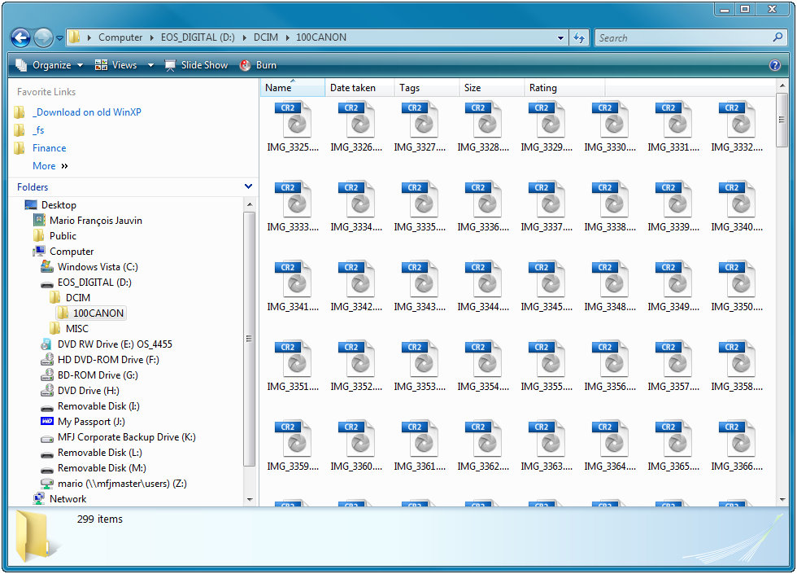

  
Remember the drive letter where your memory card appeared as (drive D: in my case) as you will use it later.  
  
Initiate transfer of photos to your PC  
  
Then you should start the Adobe Bridge (from your Photoshop installation). Once running, you can select the menu "Get Photos from Camera" as show below:  
  

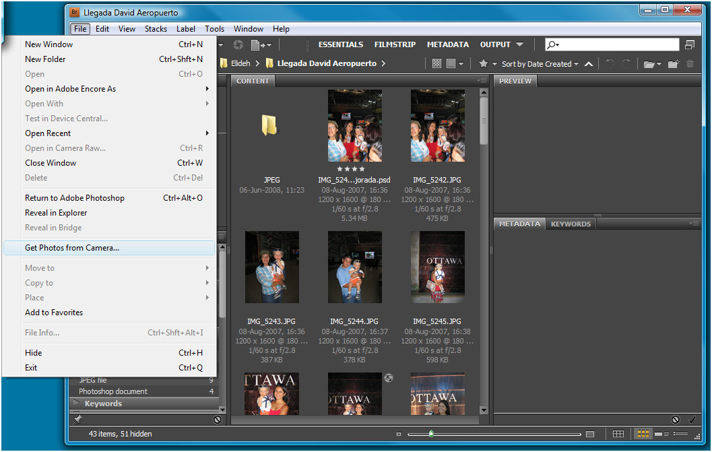

  
If you are using Photoshop CS4 as is my case, you also have this little icon in the top left area of the Bridge window:  
  
  
  
Select memory card for download  
  
Since this is most likely the first time you have use the photo downloader (this is the program invoked when doing the previous step) from Bridge, you will be using the standard window layout. You should then select the drive corresponding to the memory card that was accessed previously using the drop down menu under "Get Photos from:". In my case it was drive D: as in the picture below:  
  
  

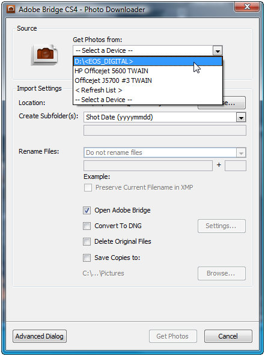

  
You will see a dialog box searching for media. Once finished, you should click on the advanced button to view the window with thumbnails for all of the photos on the memory card. This will help you make decisions in the next steps.  
  

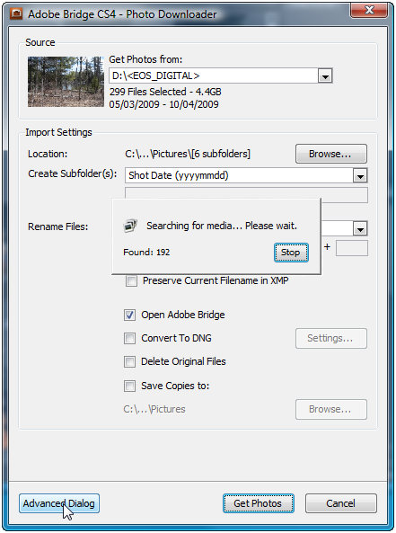

  
  
Select destination folder  
  
Here is the advanced view of the photo downloader window below. Make sure that you leave all thumbnails selected as we want to always select and process all images on the memory card. I will get back to why we do this later under the advanced options step so for now, please bear with me. You should click on the browse button to locate the folder where you want to copy your images to.  
  

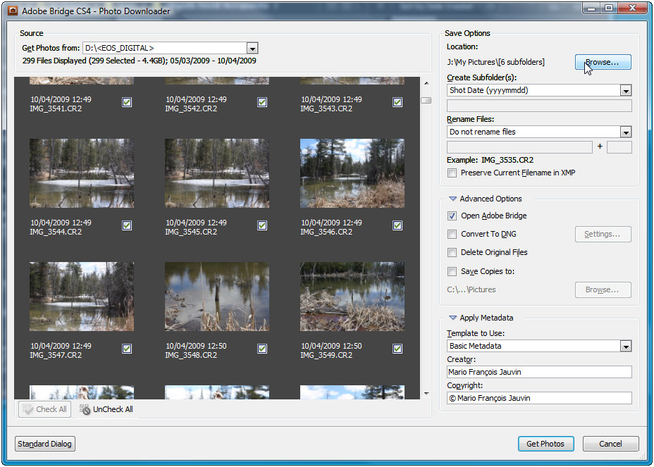

  
In my case, I selected folder "J:\\My Pictures". I would like to make a parenthesis on this very important point. As an amateur photographer and I also believe as a professional one too, it is very important to have two very important attributes for your photo library:  
  

1.  Mobility: you want to be able to look at your pictures wherever you are in different context so that you can show case them in front of a client or simply refer to them when on the road.
2.  Backup: you must always make backup copies of your photos and although I do not yet have this builtin the workflow, I will be making hints to this.

To achieve these attributes (especially the first one) I strongly advise you to acquire a small USB powered external drive (as for example the [Western Digital Passport](http://www.wdc.com/en/products/products.asp?driveid=525) which now comes in 500GB size). I say USB powered because they are much smaller and not having to look for a wall plug is extremely handy especially in a rush or using a laptop. This is what my J: drive is in this workflow.  
  
Destination subfolder settings  
  
You will see under location the mention \[6 subfolders\] appended to the selected folder. This is due to the default selection of "Shot Date (yyyymmdd)" for the subfolder option and means that with the images in the selected memory devices, 6 different subfolders would be created. Instead I recommend to select the "Custom Name" option from the "Create Subfolder(s):" drop down as below:  
  

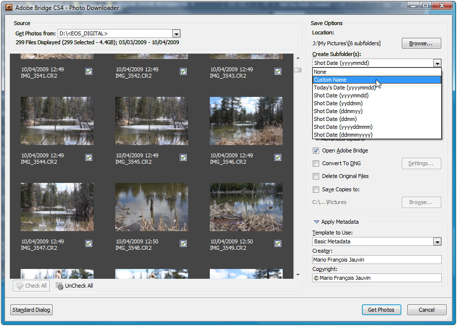

  
Once selected, a text box below will appear with the words "Enter custome name here" already selected:  
  

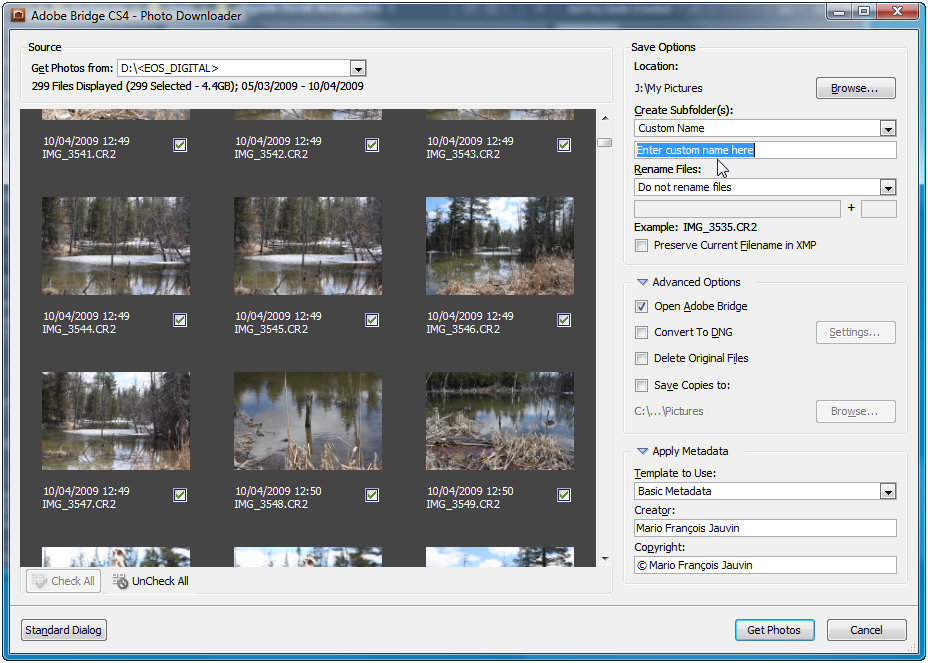

  
  
Destination subfolder name  
  
Do not click in the text box. This will deselect the text and you will have to erase it manually. Simply start typing the name of the subfolder you want to create for this operation. But before you start typing, let me give you my blurb first.  
  
Inside the memory card, I could have pictures from either one shoot or multiple shoots as is the case here. When you have multiple shoots (even on the same day) here is my suggestions on how to proceed. First pick one particular shoot in your list of images. This is where the thumbnails view in the advanced settings is useful. This could be the most important one or the one with the largest number of images but it does not really matter. In my case, I decided that the shoot I selected was the one with pictures of my mother-in-law's birthday party and hence I picked the subfolder name "Cumpleaños de mi suegra" (spanish version of Mother-in-law birthday) and then I prefixed YYYYMM which is the year and two letter month number when the pictures were taken followed by a space so that the full subfolder name is:  
  
"200903 Cumpleaños de mi suegra"  
  
Please note the 0 (zero) prefix in the month number when there is only 1 digit in the month number. This is important for sorting folder names in Windows Explorer or Bridge.  
  
Destination filenames  
  
When copying files from the memory card, names such as IMG\_2574.CR2 are meaningless. Therefore, you should select the option "Shot Date (yyyymmdd)" from the "Rename Files:" drop down menu:  
  

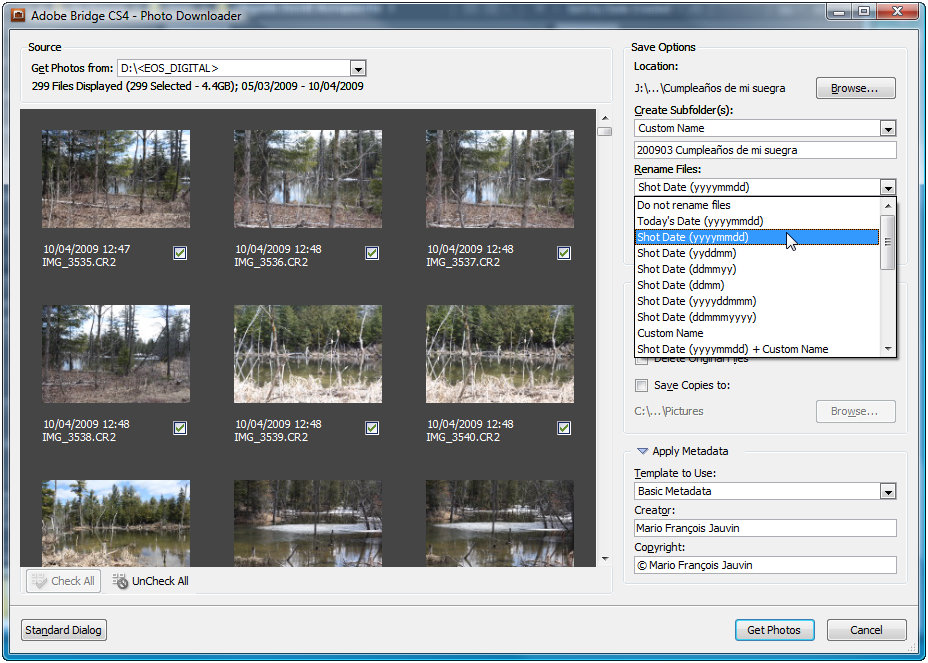

  
Once selected, a text box below the drop down will appear with a number. This number will increment for each image and will be kept and maintained by this instance of Adobe Bridge.  
  
Advanced options  
  
The remaining options should be selected as follow. "Open Adobe Bridge" should be selected and will cause a new windows with Bridge to be opened once all of the processing is completed. "Convert To DNG" should be selected to convert the camera RAW proprietary format (Canon RAW in my case) to the Adobe digital negative format (DNG). This will create smaller files and will store different camera RAW files in one consistent format. Please note that there is no difference in the information stored by a DNG file and the camera RAW file, i.e. the image quality is identical. One major distinction is that metadata is kept within the DNG file as opposed to side XMP files as in camera RAW formats. This makes it easier to handle and move raw files around. "Delete Original Files" should be selected as this will guaranty that once you have processed a file you will never be confused and process it again. This is a new option in Bridge CS4.  
  
When I started in this business of processing images on my memory card, I was trying to be purist and make sure I processed images 1-107 as shoot xyz then images 108-256 as shoot abc etc. Invariably, I would always get confused and go nuts trying to figure out whethere I had or not processed this image and I either missed some files or had duplicates. In order to avoid this I humbly ask all men and women of the earth doing digital photography to adopt the following brain dead and hence, error free, paradigm:  
  

-   If a file resides on your memory card, it has not been processed
-   If a file has been processed, it will not be on your memory card

This means that at any time, you pick up your camera, your memory card and off you go. You don't have to worry whether these files on your card have been processed and hence can be erased when you are on site and doing the shoot. You know they have not been processed so if you are out of space, get your backup memory card. We all have one, don't we? I personally have a 16GB main card for all my shootings and a backup 8GB for when I am either really lazy or I am extremely zealous taking pictures.  
  
Metadata option  
  
If you are like me, you are not into spending hours post processing images and in order to save work after, I have some advice. In the "Template to Use:" drop down, I suggest you to select "Basic Metadata". This will create two text boxes, one for "Creator:" and one for "Copyright:". You should put your name in the first and a copyright notice in the next one. To get the © symbol in windows you can press and hold the ALT key, then using the numeric keypad with the Num Lock turned on, type 0169 then release the ALT key. You can find out other codes by typing charmap at the run command. This will bring the character map windows utility.  
  
If you want to add more metadata, then before invoking photo downloader, you should go to the Bridge and select the appropriate command from the Tools menu. Once created, your metadata template will appear in the "Template to Use:" drop down.  
  
This is it, most of the "hard" work is done. This is how your photo downloader window should look like before you press the "Get Photos" button:  
  

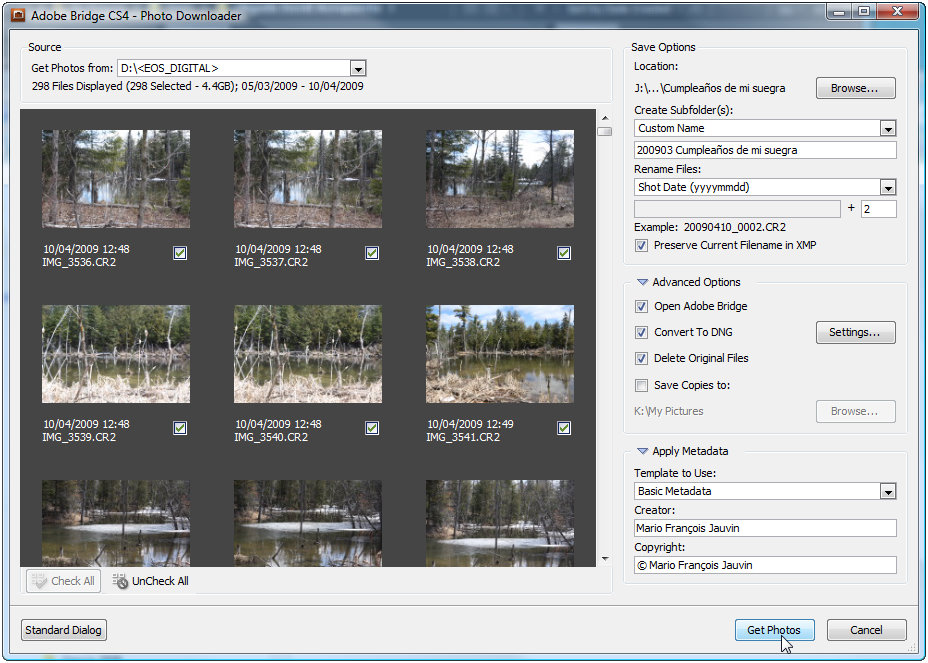

  
And then the usual progress dialog box. One when copying a file and the second when converting the file to DNG format.  
  

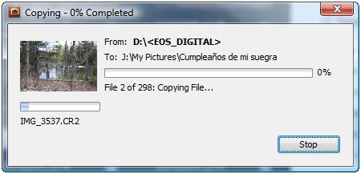

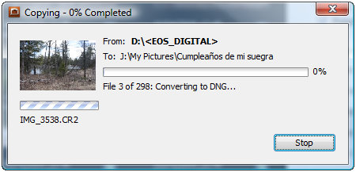

  

If you have CS4 and have, as I sermonized you for the last while, the option to delete the files turned on you should get the following two prompts. Make sure that nothing went wrong during the copy process and then confirm the deletion as below:  
  

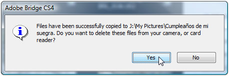

  

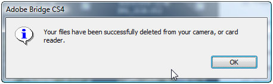

  
Moving images to appropriate folders (optional)  
  
We are almost there. At the beginning, I mentioned that my memory card had several photo shoots on it. You should select the beginning photo of each shoot and then navigate to the ending photo of the shoot and then select Stack/Group as Stack menu option as in the screen shot below:  
  

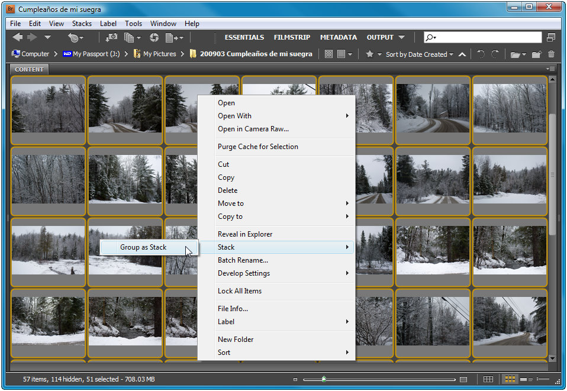

  
  
  
You should see as many stacks in the Bridge window as there were shoots. The number in the upper left corner of each stack is the number of images included. You should create as many folders (create them inside the subfolder selected earlier as it is far simpler to do it that way) as you have stacks. Remember to use the YYYYMM space naming convention.  
  
  

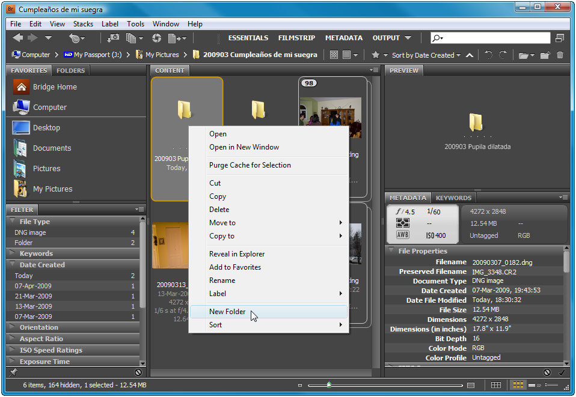

  
You should be left with a screen looking something like that:  
  

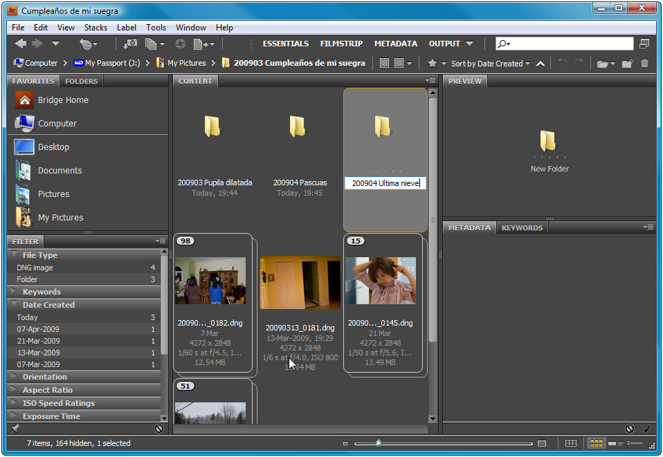

  
What you need to do is click the number in the upper left corner of a stack that you want to process. This will open the stack and select all pictures inside the stack. You should then simply drag any picture from the stack into the corresponding folder which should be in view as in the screen shot below:  
  

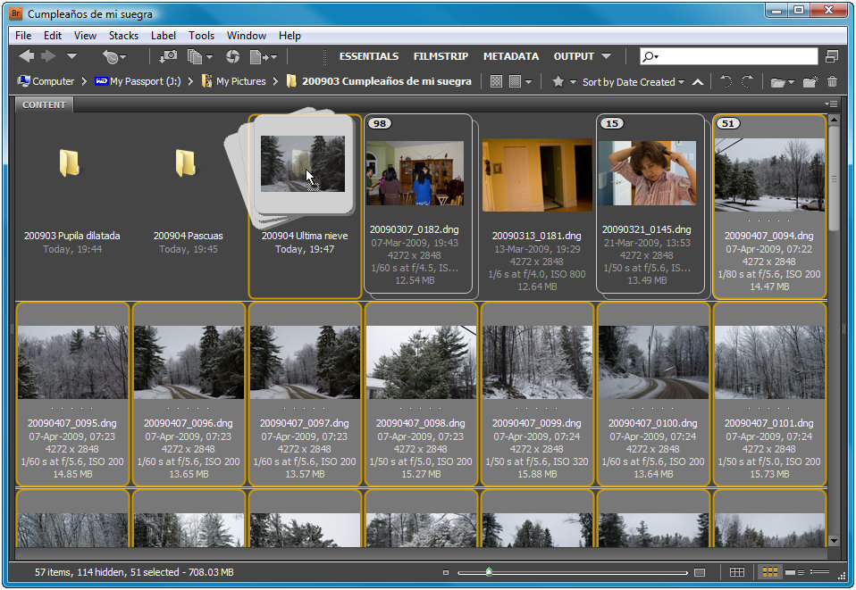

  
And the usual progress dialog box:  
  

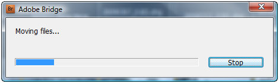  
  

Once you have move all of the images into their corresponding folders, you should simply move each folder in their appropriate location and that should be all.  
  
I hope this was instructive and useful.
