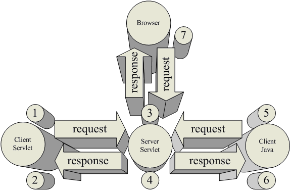

## Introduction

Multipart mime encoded is a format used to transmit binary and arbitrary data in 1 single HTTP request transaction. In this post, I will describe how to create and process multipart form data using Spring 3.1, the leading industry standard java application framework for creating Java web application.  I will start the discussion from the user perspective by talking about two main use cases and will expand it by describing how these two use cases translate into 7 possible application system use cases.

## Use Cases

Here are some use cases of this feature:

  

1.  A browser submits or uploads a file to a web server using an HTML page. This is by far the most common use case of the multipart form data feature. A multipart is required because the form data and the file are both included in the request body.
2.  A java program (a java application or servlet instance) sends multipart form data to a web server (most likely a web service).  This is a much less infrequent use case of multipart form data

  

## System Use Cases

  

The two use case scenarios above create the following 7 system use cases.

  

1.  An HTTP servlet creates the multipart form data request and sends it to a web server
2.  An HTTP servlet receives a multipart form data in the response and processes it
3.  An HTTP servlet receives the multipart form data request and processes it
4.  An HTTP servlet creates a multipart form data response and sends it back
5.  A java application creates the multipart form data request and sends it to a web server
6.  A java application receives a multipart form data in the response and processes it
7.  An internet browser (Internet Explorer (IE) or Firefox) creates the multipart form data request and sends it to a web server

  

See “Figure 1: System user case scenarios” below for an illustration where the numbers represent the system use cases:

  

Please note that IE 6 and 8 and Firefox 6 (and to the best of my knowledge all other browsers) do not support the ability to process multipart form data in an HTTP response.

  

[Figure](http://www.blogger.com/blogger.g?blogID=2678919369269748467) 1: System user case scenarios

  

Of the previous 7 system use cases, number 1 and 5 are very similar and so are number 2 and 6.  The actual SPRING code is actually identical as will be illustrated below.

  

System use case 1 and 5 (including system use case 7 which is implemented by browsers) are the most common system use case.  Even though system use case 7 is more common than system use case 1 and 5, there is ample valid requirements and system use case 1 and 5 is very well implemented in the RestTemplate Spring class.

  

System use case 3 is implemented in Spring 3.1 with the help of Apache Commons IO and FILEUPLOAD libraries.  This support is not enabled by default in Spring and must be enabled. One way to do so is to add the following bean in the application context xml file:  
  

<beans:bean id="multipartResolver" class="org.springframework.web.multipart.commons.CommonsMultipartResolver">  
<!-- one of the properties available; the maximum file size in bytes -->  
<beans:property name="maxUploadSize" value="10000000"/>  
</beans:bean>

  

System use case 4, 2 and 6 represent system use cases that are not in use in the industry.  I could not find any published example of this.  I have seen people asking questions on this topic in forums like StackOverflow but I have not found a single published case of its use. If you know of such a case, please let me know.  

  

As far as Spring is concerned, system use case 4 is actually implemented but with a bug.  The created HTTP response does not include the Content-Length HTTP header which makes it difficult for (invalid) system use case 2 and 4 which find no support in Spring 3.1.  The consequence is that in order to implement them, one would have to refit the Apache commons fileupload code to handle an HTTP response instead of an HTTP request.  Based on my test implementation, this is not easy, not portable nor extensible. It is also not desirable as multipart form data was designed to transport series of data or parts between a user and an application[\[1\]](http://www.blogger.com/blogger.g?blogID=2678919369269748467#_ftn1), which implies an HTTP request.

  

## Implementation of the system use case using Spring 3.1

  

### Creating a multipart form data HTTP request (system use case 1 and 5)

  

The following code will both work in an HTTP servlet and a java application and uses Spring’s RestTemplate.  Please note that the HttpMessageConverter referred to as mhmc (MultipartHttpMessageConverter) below corresponds to a test implementation of a message converter that can read multipart form data so as to implement the invalid system use case 2 and 6 and fix the Content-Length bug when creating the HTTP response in system use case 4.  Please note that it is not recommended to write such an implementation for the reasons listed further down.  I did it just to test all 6 system use case. If you want to test without such an implementation the other system use cases then just omit the call to setMessageConverters on the restTemplate.

  

// Replace Spring’s XmlAwareFormHttpMessageConverter with

// the one fully supporting multipart form data

RestTemplate restTemplate = new RestTemplate();

List<HttpMessageConverter<?>> mc = restTemplate.getMessageConverters();

for (Iterator<HttpMessageConverter<?>> iterator = mc.iterator(); iterator.hasNext();) {

    HttpMessageConverter httpMessageConverter = (HttpMessageConverter<?>) iterator

          .next();

    if (httpMessageConverter instanceof XmlAwareFormHttpMessageConverter) iterator.remove();

}

mc.add(mhmc);

restTemplate.setMessageConverters(mc);

ResponseEntity<MultiValueMap<String, CommonsMultipartFile>> eresp = null;

MultiValueMap<String, HttpEntity<FileSystemResource>> parts = new LinkedMultiValueMap<String, HttpEntity<FileSystemResource>>();

HttpHeaders fileHeaders = new HttpHeaders();

fileHeaders.add("Content-type",

     MediaType.APPLICATION\_OCTET\_STREAM\_VALUE);

FileSystemResource r = new FileSystemResource(SAMPLE\_REQUEST\_FILE);

HttpEntity<FileSystemResource> sample\_file = new HttpEntity<FileSystemResource>(

     r, fileHeaders);

parts.add("file1", sample\_file);

HttpHeaders reqheaders = new HttpHeaders();

// Set any custom HTTP request headers you need here

Reqheaders.set("Custom-App-Header", "custome-value");

HttpEntity<MultiValueMap<String, HttpEntity<FileSystemResource>>> ereq = new HttpEntity<MultiValueMap<String, HttpEntity<FileSystemResource>>>(  
                parts, reqheaders);  

  

### Receiving a multipart form data HTTP request (system use case 3)

  

The feature to receive multipart form data from an HTTP request in Spring comes in the form of a pluggable MultipartResolver object and is not enabled by default.  Spring provides two MultipartResolver implementations.  One makes use of the Commons FileUpload in Servlet 2.x containers and the other one for use with Servlet 3.0 multipart request parsing.  To enable the Servlet 2.x MultipartResolver, you follow the previously mentioned application context bean definition. On this has been done, all that is left is to use the request handler annotation below:

  

public ResponseEntity<MultiValueMap<String, Object>> processMultipart(@RequestPart("file1") ByteArrayResource inputfile, HttpServletRequest request) {

  

This is really quite simple and inputfile.getBtyeArray() will contain the binary data of the part encoded as file1 in the system use case 1 and 5 above. I will explain the ResponseEntity<MultiValueMap<String, Object>> return type in the next section.

## Creating a multipart form data HTTP response (system use case 4)

  

As indicated, this use case is not valid but it is almost supported by Spring 3.1.  I say almost because the HTTP response created by this process does not have an HTTP Content-Length header which can make it inefficient to process this response. The code is very similar to the code for creating an HTTP request. This due to the fact that the building of either the HTTP request or the HTTP response is handled by Spring’s HttpMessageConverter interface.

  

Set<MediaType> mediaTypes = new HashSet<MediaType>();

mediaTypes.add(MediaType.MULTIPART\_FORM\_DATA);

// Tell SPRING to only support this media type, regardless

// of what the Accept header said

request.setAttribute(HandlerMapping.PRODUCIBLE\_MEDIA\_TYPES\_ATTRIBUTE,

     mediaTypes);

MultiValueMap<String, Object> parts = new LinkedMultiValueMap<String, Object>();

HttpHeaders fileHeaders = new HttpHeaders();

fileHeaders.add("Content-type",

     MediaType.APPLICATION\_OCTET\_STREAM\_VALUE);

ByteArrayResource r = new ByteArrayResource(BINARY\_RESPONSE) {

    @Override

    public String getFilename() throws IllegalStateException {

     return "file2.txt";// this will create the filename=

                    // attribute on the content-disposition

                    // tag

    }

};

HttpEntity<ByteArrayResource> file = new HttpEntity<ByteArrayResource>(

     r, fileHeaders);

parts.add("file2", file);

HttpHeaders respHeaders = new HttpHeaders();

respHeaders.add("Custom-Header1", "custom-value");

respHeaders.add("Content-type", MediaType.MULTIPART\_FORM\_DATA\_VALUE);

ResponseEntity<MultiValueMap<String, Object>> eresp = new ResponseEntity<MultiValueMap<String, Object>>(

     parts, respHeaders, HttpStatus.CREATED);

  

Then, all that is left to do is for the servlet to return the eresp variable.  This is where the return type of ResponseEntity<MultiValueMap<String, Object>> in the previous section comes from.  Please remember that the HTTP response created by such a process will not contain the Content-Length HTTP header.  If you create a subclass of the XmlAwareFormHttpMessageConverter, modify the writeMultipart (see below) and wire this new class into Spring(see below) then you can add the Content-Length header.

  

ByteArrayOutputStream baos=new ByteArrayOutputStream();

  

… (existing code as is)

  

writeParts(baos, parts, boundary);

writeEnd(boundary, baos);

byte\[\] baosba=baos.toByteArray();

outputMessage.getHeaders().setContentLength(baosba.length);

outputMessage.getBody().write(baosba);

  

## Receiving multipart form data in an HTTP response(system use case 2 or 6)

As previously indicated, there is no support in Spring to perform this at all.  One has to take the existing code in org.springframework.web.multipart.commons.CommonsFileUploadSupport and adapt it to a message converter.  This make the code both non portable and non extensible and I do not advise it.

  

* * *

[\[1\]](http://www.blogger.com/blogger.g?blogID=2678919369269748467#_ftnref1) See RFC 2388, section 2 and 3
