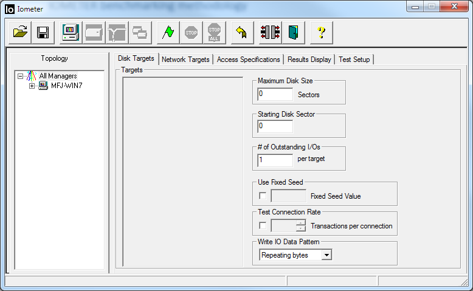
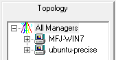
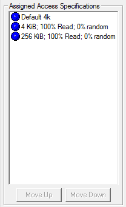
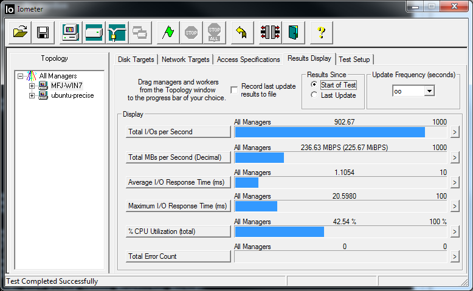
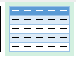
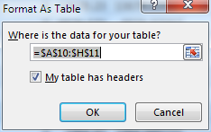

The following document describes the methodology used at MFJ Associates for running a disk I/O benchmark.  This document assumes that the IOMETER software has been downloaded from [www.iometer.org](http://www.iometer.org/). IOMETER runs on Microsoft Windows as well as various flavors of Unix and Linux(referred to as \*nix in this blog). It is made up of two components:  

1.  iometer.exe a GUI program that only runs on Windows (which means you have to have at least 1 Windows desktop or server to run the GUI part)
2.  dynamo.exe or dynamo (on \*nix) called the manager.

In order to run a benchmark the Windows computer running iometer.exe must have TCP connectivity with the computer(s) where the benchmark will be performed.  Both must be able to connect to one another.  
  
**How to run a benchmark**  
  
Here is a high level view of running a benchmark. A detailed explanation will follow.  

1.  You need to start the iometer.exe program on the Windows computer.  This will start the dynamo.exe program on that same computer in order to be able to perform benchmarks on that Windows computer.
2.  Start the dynamo program on all computers (Windows or \*nix) where you want to run a benchmark.  If you need to run benchmark on two Linux servers la and lb and 1 windows server wa then you must start the dynamo program on the la, lb and wa servers.
3.  When you have configured all the parameters for running the benchmark simply click on the start icon ()
4.  When the benchmark run time is reached (or you click the stop icon if the duration is specified as 0) then the result of the benchmark will be written into a csv file.

That's it.  Now for the details read on.  
  
**Start IOMETER.exe**  
  
After starting iometer.exe you will get the following window:  In the topology window you should see under All Managers an icon with a plus sign corresponding to the Windows computer where you are running the iometer.exe.  This indicates that iometer.exe started the dynamo.exe on the Windows computer and that it has connected to the iometer GUI.  If you click on the plus sign you will see a list of workers, one for each CPU on the computer running the dynamo program (in this case the same Windows computer running the iometer.exe).  This means that there are up to so many workers potentially available to perform tests. The number of worker that will be utilized depends on the number of disk targets that are selected.  All disk targets will be distributed among the workers equally.  If there are 4 workers:  

-   1 disk, only 1 of 4 worker will be used
-   2 disks, 2 of 4 workers will be used
-   4 disks, all 4 workers will be used
-   8 disks, all 4 workers will be used each using two disks

  
  
**Start dynamo**  
  
Logon to each computer where you want to run a benchmark and start the dynamo program as follow:   dynamo -i **_iometer_** \-m _**manager**_ where **_iometer_** is the hostname or IP address of the computer running iometer that this instance of dynamo will try to connect to **_manager_** is the hostname or IP address of the computer running dynamo. This hostname or IP address will be used by the computer running the iometer program. Once you start a dynamo, you will see it appear in the topology list of iometer as ubuntu-precise in the screen shot below:   
  
**Configure the parameters**  
  
In order to run a benchmark, you must configure all the managers that will be used in the iometer topology window.  To do this you **must click each manager in the topology and perform the following steps**:  

1.  click the Disk Targets tab and select the disks to use in the benchmark. Control click will select multiple disks or to select no disk, control click all selected disks to deselect them.  A disk is selected when it has a red x in the check box as in
2.  Select a maximum disk size of 2000 sectors
3.  Click the Access Specifications tab and click the global access specification called Default.  Click the Edit Copy button.
4.  In the Edit access Specification window, change the name to Default 4k
5.  Change the Transfer Request Size to 4 Kilobytes then click the OK button
6.  Back in the Access Specifications with the new Default 4k selected at the bottom of the list click the <<Add button. Click the "4 KiB; 100% Read; 0% random" access specification and add it by clicking the <<Add button. Do the same for the "256KiB; 100% Read; 0% random" access specification. You should end up with the following in the Assigned Access Specifications window:  
    
7.  Click the Results Display tab.  Change the Update Frequency to 5 seconds.
8.  Click the Test Setup tab and type a test description.  Then select a 1 minute run time

Remember to perform each of those steps for each connected dynamo or manager.  Note that steps 3-5 only need to be done the first time.  
  
**Start the benchmark**  
  
Once all managers have been configured, you are ready to run the benchmark.  Please note that all workers on all managers will be running their first access specification at the same time, followed by their second access specification and so on.  If they are all hitting the same disk they will each interfere with one another.  On a production system this can provide comparable measures as all benchmark are equally affected by the other activities.  If you want to run them separately, just make sure that only 1 disk target is selected at a time. Since you have configured three access specification and a run time of 1 minutes, this means that the complete benchmark will take 3 minutes. When ready, click the start green flag. A dialog box will appear allowing you to specify the filename of the CSV result file.  Make sure you store it in a location and using a name that will reflect what the benchmark was about.  When you click the save button the benchmark will start.  Make sure you are on the Results Display tab to see the progress. This is what it will look like:  
  
  
**End of benchmark**  
  
When the benchmark has completed you can import it into Excel and select the top left cell of the first result (with the text 'Target Type) and shift click the bottom right cell of the last result. On the Excel Home tab in the Styles group select the Format as Table button  and click the Table Style Medium 2  and click OK on the following window making sure the My table has headers is selected as in:  
  
This will create an Excel table that you can use to filter.  I usually filter the target types of ALL, MANAGER and DISK to gain an understanding.  You may want to remove the filters to look at detailed information. See the iometer User's Guide for a description of the metrics.  Please note that binary metrics(MiBps) versus decimal metrics(MBps) are defined in the table in the following [web page](http://shareprogrammingtips.com/confusion-with-megabytes-1-megabyte-is-1-million-bytes-or-1024-1024-1048576-bytes/)  
  
**Other benchmarking tools**  
  

1.  [fio](http://freecode.com/projects/fio "Information on fio I/O benchmarking tool") benchmark for \*nix and Windows
2.  [diskspd](https://blogs.technet.microsoft.com/josebda/2014/10/13/diskspd-powershell-and-storage-performance-measuring-iops-throughput-and-latency-for-both-local-disks-and-smb-file-shares/) from Microsoft that runs only on Windows
