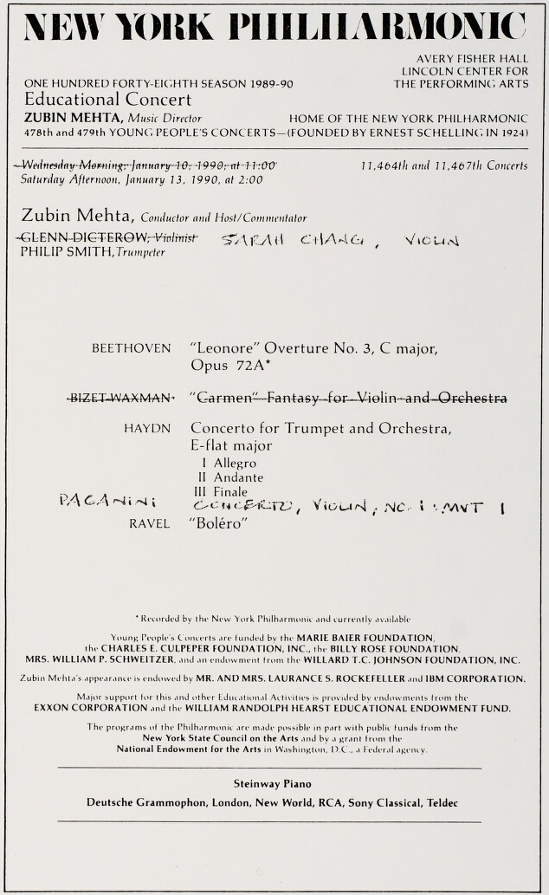

I have always been fascinated, as many of you have been, by the unbelievable qualities demonstrated by true child prodigy.  One such person I have been especially fascinated by is the internationally acclaimed violinist Sarah Chang ([home page](http://sarahchang.com/), [@sarahchang](https://twitter.com/sarahchang)).  
  
There was no internet in 1986 when Sarah Chang auditioned at the tender age of 5 for Juillard playing Bruch's violin concerto.  However fortunately we can have a glimpse of what an unbelievable talent she had at this age thanks to a video of her playing [around that age](https://theviolinchannel.com/sarah-chang-rondo-capriccioso-5-1986/).  The sound and video quality is not great but it is such a fantastic historic artifact.  
  

  
  
When she had just turned 9 (I know lots say 8 but she turned 9 on December 10, 1989), Zubin Mehta then conductor of the New York Philharmonic called her up on Thursday January 11, 1990 to ask her if she would audition the next day.  After the audition he called her back to ask her if she could play the next day to replace then Concert master Glenn Dicterow, but that there was just one little problem; there was no rehearsal time available so she would have to play without rehearsing first.  She accepted and this is how Sarah debuted.  
  
Here is a copy of the program that comes from the New York Philharmonic [archives](https://archives.nyphil.org/index.php/artifact/c98c2199-958b-42e9-86cf-7c34a6333710-0.1/fullview#page/1/mode/1up).  
  

  

This is the text from the program (with handwritten annotations in _courrier italic font_):

  

Educational Concert   
ZUBIN MEHTA, Music Director HOME OF THE NEW YORK PHILHARMONIC   
478th and 479th YOUNG PEOPLE'S CONCERTS (FOUNDED BY ERNEST SCHELLING IN 1024)   
~Wednexday Morning, January 10, 1990 at 11:00~ 11,464th and ll,467th Concerts   
Saturday Afternoon, janunry 13, 1990, at 2:00   
Zubin Mehta, Conductor and Host/Commentator   
~GLENN DICTEROW, Violinist~ _SARAH CHANG, VIOLIN_  
PHILIP SMITH,Trumpeter   
BEETHOVEN "Leonore" Overture No. 3, C major, Opus 72A\*   
~BIZET-WA~~XMAN  "Carmen" Fantasy for Violin and Orchestra~   
HAYDN   
Concerto for Trumpet and Orchestra,   
E-flat major   
I Allegro   
II Andante 

lll Finale 

_PAGANINI  CONCERTO, VIOLIN, NO. 1, MVT 1_

  

RAVEL "Bolero"   
\* Recorded by the New York Philharmonic and currently available   
Young People s Concerts are funded bv the MARIE BAIER FOUNDATION, the CHARLES E. CULPEPER FOUNDATION, INC., the BILLY ROSE FOUNDATION MRS. WILLIAM P. SCHWEITZER, and an endowment from the WILLARD T.C. JOHNSON FOUNDATION, INC.   
Zubin Mehta's appearance is endowed by MR. AND MRS. LAURANCE S. ROCKEFELLER and IBM CORPORATION.   
Major support for this and other Educational Activities is provided bv endowments from the   
EXXON CORPORATION and the WILLIAM RANDOLPH HEARST EDUCATIONAL ENDOWMENT FUND.   
The programs of the Philharmonic are made possible in part with public funds from the New York State Council on the Arts and by a grant from the National Endowment for the Arts in Washington, D.C., a Federal agency.   
Steinway Piano   
Deutsche Grammophon, London, New World, RCA, Sony Classical, Teldec
