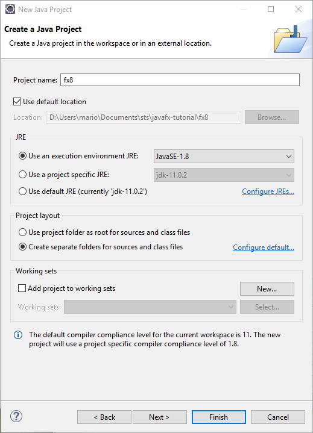
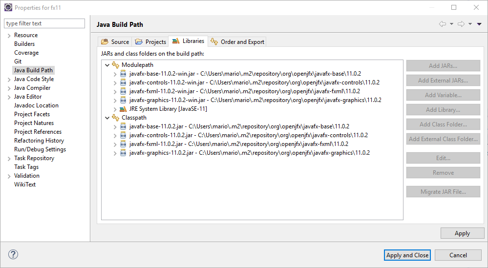

Since the decoupling of javaFX from the JDK (see [http://openjfx.io](http://openjfx.io/)) it has become somewhat of a challenge to use javaFX with the new module capability since java 9.  This tutorial is a brief roadmap between a java 8 javafx to the java 11 version.  All code for this sample resides in [https://github.com/marioja/javafx](https://github.com/marioja/javafx) and can be imported into eclipse and should run as is.  You can also do this manually following these instructions.  
  
First you need to use an eclipse that supports the java 11 execution environment (Eclipse 2018-12 at the time of this writing).  Then you need to make sure you have a java 11 jdk installed(11.0.2 at the time of this writing).  I downloaded [openjdk11](http://jdk.java.net/11/) and unzipped into a folder on my home directory (user profile on windows).  Lets call this directory jdk-11.0.2.  You should add the eclipse [-vm argument in the eclipse.ini file](https://wiki.eclipse.org/Eclipse.ini) to select jdk-11.0.2.  
  
Start eclipse and create a brand new workspace (one that does not exist).  I called it javafx-tutorial.  If you want to be able to follow please do not take shortcuts as creating a new workspace will create all defaults necessary for this to work.  
  
In this new workspace, create a new java 8 JRE based on a installed JDK 8.  A JRE will not suffice as the javafx in java 8 is found in the JDK.  If you do not want to verify that the fx8 project runs than you do not need this JRE configured in eclipse.  
  

## Java 8 sample

Create a new java project using the following template:

  

You should then create an additional java source folder called resources and create the fx.sample package in both the src and resources folders.

  

Add the following java programs in the src fx.sample package:

  

**Main.java**

  

  

package fx.sample;

  

import java.io.IOException;

  

import javafx.application.Application;

import javafx.fxml.FXMLLoader;

import javafx.scene.Parent;

import javafx.scene.Scene;

import javafx.stage.Stage;

  

public class Main extends Application {

  

@Override

public void start(Stage primaryStage) throws Exception {

try {

Parent root = FXMLLoader.load(getClass().getResource("Main.fxml"));

Scene scene = new Scene(root,900,500);

primaryStage.setScene(scene);

primaryStage.show();

} catch(IOException e) {

throw new IllegalStateException("Unable to load view:", e);

}

}

  

public static void main(String\[\] args) {

launch(args);

}

}

  

  

**SampleController.java**

  

  
package fx.sample;  
  
import javafx.event.ActionEvent;  
import javafx.fxml.FXML;  
import javafx.scene.text.Text;  
  
public class SampleController {  
    @FXML private Text actiontarget;  
     
    @FXML protected void handleSubmitButtonAction(ActionEvent event) {  
        actiontarget.setText("Sign in button pressed");  
    }  
  
}  

  

In the resources fx.sample package add the following files:

  

**Login.css**

  

  
root {  
    display: block;  
}  
  
.root {  
     -fx-background-image: url("background.jpg");  
}  
  
.label {  
    -fx-font-size: 12px;  
    -fx-font-weight: bold;  
    -fx-text-fill: #333333;  
    -fx-effect: dropshadow( gaussian , rgba(255,255,255,0.5) , 0,0,0,1 );  
}  
  
#welcome-text {  
   -fx-font-size: 32px;  
   -fx-font-family: "Arial Black";  
   -fx-fill: #818181;  
   -fx-effect: innershadow( three-pass-box , rgba(0,0,0,0.7) , 6, 0.0 , 0 , 2 );  
}  
  
#actiontarget {  
  -fx-fill: FIREBRICK;  
  -fx-font-weight: bold;  
  -fx-effect: dropshadow( gaussian , rgba(255,255,255,0.5) , 0,0,0,1 );   
}  
  
.button {  
    -fx-text-fill: white;  
    -fx-font-family: "Arial Narrow";  
    -fx-font-weight: bold;  
    -fx-background-color: linear-gradient(#61a2b1, #2A5058);  
    -fx-effect: dropshadow( three-pass-box , rgba(0,0,0,0.6) , 5, 0.0 , 0 , 1 );  
}  
  
.button:hover {  
    -fx-background-color: linear-gradient(#2A5058, #61a2b1);  

}

  

**Main.fxml**

  
  

  
<?xml version="1.0" encoding="UTF-8"?>  
  
<?import java.lang.\*?>  
<?import java.net.\*?>  
<?import javafx.geometry.\*?>  
<?import javafx.scene.control.\*?>  
<?import javafx.scene.layout.\*?>  
<?import javafx.scene.text.\*?>  
  
<GridPane alignment="center" hgap="10" styleClass="root" vgap="10" xmlns:fx="http://javafx.com/fxml/1" xmlns="http://javafx.com/javafx/8" fx:controller="fx.sample.SampleController">  
  <padding><Insets bottom="10" left="25" right="25" top="25" /></padding>  
   <children>  
     
     <Text id="welcome-text" text="Welcome" GridPane.columnIndex="0" GridPane.columnSpan="2" GridPane.rowIndex="0" />  
     
     <Label text="User Name:" GridPane.columnIndex="0" GridPane.rowIndex="1" />  
     
     <TextField GridPane.columnIndex="1" GridPane.rowIndex="1" />  
     
     <Label text="Password:" GridPane.columnIndex="0" GridPane.rowIndex="2" />  
     
     <PasswordField fx:id="passwordField" GridPane.columnIndex="1" GridPane.rowIndex="2" />  
     
     <HBox alignment="bottom\_right" spacing="10" GridPane.columnIndex="1" GridPane.rowIndex="4">  
        <children>  
            <Button text="Sign In" />  
        </children>  
     </HBox>  
     
     <Text fx:id="actiontarget" GridPane.columnIndex="0" GridPane.columnSpan="2" GridPane.halignment="RIGHT" GridPane.rowIndex="6" />  
   </children>  
   
  <stylesheets>  
    <URL value="@Login.css" />  
  </stylesheets>  
   <columnConstraints>  
      <ColumnConstraints />  
      <ColumnConstraints />  
   </columnConstraints>  
   <rowConstraints>  
      <RowConstraints />  
      <RowConstraints />  
      <RowConstraints />  
      <RowConstraints />  
      <RowConstraints />  
      <RowConstraints />  
      <RowConstraints />  
   </rowConstraints>  
   
</GridPane>  
  
  
You should get the background.jpg image from the github project and add it to the resources fx.sample package (or folder).  
  
You should make sure that the build path defines a java 8 JDK and you should then be able to run the javafx 8 sample.  
  

## fx11

  
To make this project run under java 11 you need to change the execution environment to a jre 11 and you need to download the dependencies from the sample mfx11 sample (no code, just a pom file).  You can do that by right mouse clicking the mfx11 project and selecting maven/update project.  
  
You can then go back to the fx11 project and make the following build path changes by clicking the add external JARs button and selecting the files from your maven local repository:  
  

  
You can then run the fx11 Main launch configuration.  

## mfx11-2

Now we are going to turn this pure javafx sample into a maven project.  You can create the new maven simple (not archetype) project and copy your code from fx11 into the proper packages/folders.  You need to modify the pom file to add the build plugins for exec-maven-plugin and the maven-compiler-plugin:

<project xmlns="http://maven.apache.org/POM/4.0.0" xmlns:xsi="http://www.w3.org/2001/XMLSchema-instance" xsi:schemaLocation="http://maven.apache.org/POM/4.0.0 http://maven.apache.org/xsd/maven-4.0.0.xsd">

  <modelVersion>4.0.0</modelVersion>

  <groupId>fx.sample</groupId>

  <artifactId>mfx11</artifactId>

  <version>0.0.1-SNAPSHOT</version>

  <dependencies>

  <dependency>

  <groupId>org.openjfx</groupId>

  <artifactId>javafx-fxml</artifactId>

  <version>11.0.2</version>

  </dependency>

  </dependencies>

  <build>

  <plugins>

  <plugin>

  <artifactId>maven-compiler-plugin</artifactId>

  <version>3.8.0</version>

  <configuration>

  <release>11</release>

  </configuration>

  </plugin>

  <plugin>

  <groupId>org.codehaus.mojo</groupId>

  <artifactId>exec-maven-plugin</artifactId>

  <version>1.6.0</version>

  <executions>

  <execution>

  <goals>

  <goal>java</goal>

  </goals>

  </execution>

  </executions>

  <configuration>

  <mainClass>fx.sample.Main</mainClass>

  </configuration>

  </plugin>

  </plugins>

  </build>

</project>

You can then run the Maven build configuration mfx11-2

## mfx11boot

This is the final sample that adds Spring Boot to the maven javafx 11 sample.  To do this, you need to change the Main.java as such:

  

package fx.sample;

  

import java.io.IOException;

  

import org.springframework.boot.SpringApplication;

import org.springframework.boot.autoconfigure.SpringBootApplication;

import org.springframework.context.ConfigurableApplicationContext;

  

import javafx.application.Application;

import javafx.fxml.FXMLLoader;

import javafx.scene.Parent;

import javafx.scene.Scene;

import javafx.stage.Stage;

  

@SpringBootApplication

public class Main extends Application {

  

private static String\[\] savedArgs;

private ConfigurableApplicationContext context;

  

@Override

public void init() throws Exception {

this.context=SpringApplication.run(Main.class, savedArgs);

}

  

@Override

public void stop() throws Exception {

context.close();

System.gc();

System.runFinalization();

}

private Object createControllerForType(Class type) {

return this.context.getBean(type);

}

  

@Override

public void start(Stage primaryStage) throws Exception {

try {

FXMLLoader loader=new FXMLLoader(getClass().getResource("Main.fxml"));

loader.setControllerFactory(this::createControllerForType);

Parent root = loader.load();

Scene scene = new Scene(root,900,500);

primaryStage.setScene(scene);

primaryStage.show();

} catch(IOException e) {

throw new IllegalStateException("Unable to load view:", e);

}

}

  

public static void main(String\[\] args) {

savedArgs=args;

launch(args);

}

}

  

You need to add the parent org.springframework.boot:spring-boot-starter-parent:2.1.2.RELEASE to the pom file.  You then need to add the org.springframework.boot:spring-boot-starter dependency.

  

Last but not least, you need to add the @Component annotation to the SampleController.java class so that it may be found in the Spring context.  You should then be able to run the mfxboot launch configuration.
